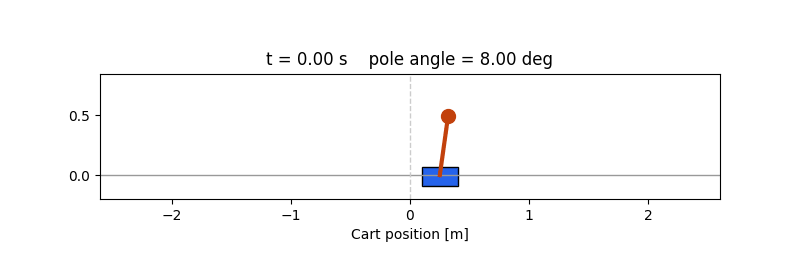

# Cart-Pole Balance with Cascade PID

Nonlinear cart-pole modeling and cascade PID/PD control, with a [report](assets/main.pdf) on local stability and simulations in MATLAB and Python.



## Implementations

| Implementation | Model and input |
| --- | --- |
| [Custom Python simulation](cartpole_custom.py) | Nonlinear point-mass model from the report. The applied force can vary between −10 and +10 N. |
| [Gymnasium `CartPole-v1`](cartpole_gym.py) | Gymnasium’s built-in model. The sign of the requested force selects either −10 N or +10 N. |
| [MATLAB/Simulink](cartpole.slx) | Block-diagram implementation of the point-mass model and cascade controller. |

## Run the Python examples

From the repository folder, install the dependencies and run either example.

```bash
python -m pip install numpy matplotlib pillow "gymnasium[classic-control]"

python cartpole_custom.py --render
python cartpole_gym.py --render
```

[Custom simulation](assets/cartpole_custom.gif) · [Gymnasium](assets/cartpole_gym.gif)

## Compare the controller terms

Both Python scripts support `--no-d` to disable both derivative terms. The remaining gains stay at their original values.

```bash
python cartpole_gym.py --episodes 20
python cartpole_gym.py --episodes 20 --no-d
```

[Custom simulation without derivative terms](assets/cartpole_custom_no-d.gif) · [Gymnasium without derivative terms](assets/cartpole_gym_no-d.gif)

## Run the Simulink model

Open the repository folder in MATLAB and run `run_cartpole`. Edit `cfg.initial`, `useIntegral`, or `useDerivative` in [run_cartpole.m](run_cartpole.m) to change the experiment.

[View the Simulink response](assets/cartpole_response_simulink.png)